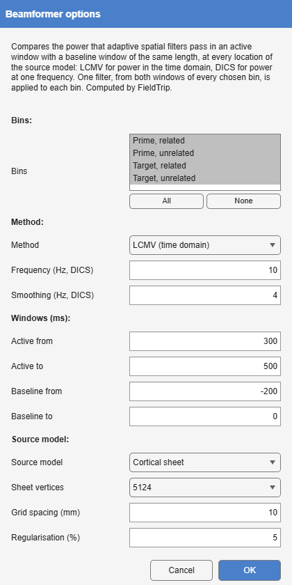
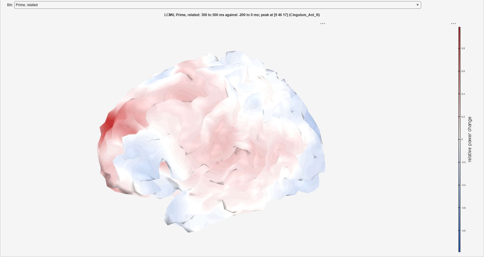
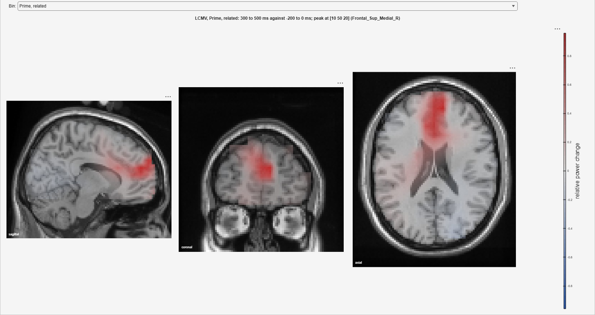

*Tools > 4. Frequency and Component Analysis > Beamformer · epoched →
averaged, with a map of power change · `Beamformer`*

Where power changes between a baseline window and an active window of the
same length, at every location of a source model, by FieldTrip's
beamformers [@vanveen1997; @gross2001]. **LCMV** compares power in the time
domain, from the covariance of the trials; **DICS** compares power at one
frequency, from their cross-spectra, which suits an induced oscillation or a
frequency-tagged response. The result is the trials' average, as Average
makes it, with the map stored beside it; the view draws the map
([Beamformers](https://markspan.github.io/Alakazam/#sec-beamformers)).

{#fig-beamformer-dialog}

| Option | Default | Meaning |
|--------------|------------------------|-------------------------------------------------------|
| **Bins** | every ordinary bin | The bins mapped; their trials together make the filter. |
| **Method** | LCMV | **LCMV (time domain)** or **DICS (frequency)**. |
| **Frequency**, **Smoothing** | 10 Hz, 4 Hz | DICS only: the frequency, and the multitaper smoothing around it. |
| **Active from/to**, **Baseline from/to** | 300 to 500, -200 to 0 ms | The two windows compared. They must be of the same length. |
| **Source model** | Cortical sheet | The template **Cortical sheet**, or a regular **Volume grid** inside the template brain. |
| **Sheet vertices** | 5 124 | The sheet: 5 124, 8 196 or 20 484 vertices. |
| **Grid spacing** | 10 mm | The grid. |
| **Regularisation** | 5 % | The diagonal loading of the covariance or cross-spectra, as a percentage of the mean sensor power, FieldTrip's `lambda`. |

: Beamformer's options. {#tbl-beamformer}

The value at each location is the relative change, (active - baseline) /
baseline, so 1 means the power doubled. A trial rejected anywhere in either
window takes no part; the view says how many did.

{#fig-beamformer-result}

{#fig-beamformer-grid}
